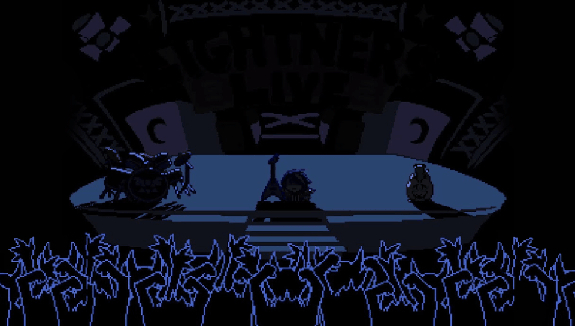

  An experimental, unofficial port of <a href="https://ezioeagle.itch.io/lightners-live-plus"><strong>Deltarune: Lightners Live Plus</strong></a> for PlayStation Vita.

  <em>Powered by a customized <a href="https://github.com/WolffsRoom/godot4-vita">Godot 4 Vita</a> runtime, with native GXM 2D rendering and a Vita-made Deltarune-style interface.</em>

> [!IMPORTANT]
> **Work in progress!**
> The port boots and plays songs on real PS Vita hardware, but there is **no public build yet**. Get the original game on [itch.io](https://ezioeagle.itch.io/lightners-live-plus). This repository does not distribute the game's files.

## Project status

  
  
   
  
  

 

All 121 built-in songs load and play on the Vita with notes in sync with the music. The current work is a Vita-native presentation inspired by the Chapter 3 *Lightners Live* show.

| Component | Current state |
| :--- | :--- |
| Boot / LiveArea | Animated 960 × 544 startup, custom LiveArea |
| Opening | Recreation of the first Lightners Live stage from Chapter 3 |
| Menus | New Deltarune-style title, options, song select and dialog boxes |
| Gameplay | All built-in songs playable; hold notes, sparks and lane borders drawn natively |
| Audio | Music, notes, character voices and UI sounds working |
| Loading | Game data packed into a single `game.pck` |
| Custom maps | Same interface as the song select |
| Languages | English, Spanish and Brazilian Portuguese |
| Public VPK / Release | Not available yet |

_If you enjoy my work, consider supporting the development!_

 <strong>Support this and other projects</strong></a>

## In motion

  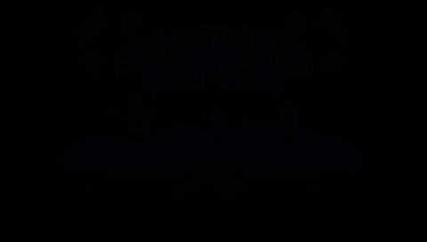
  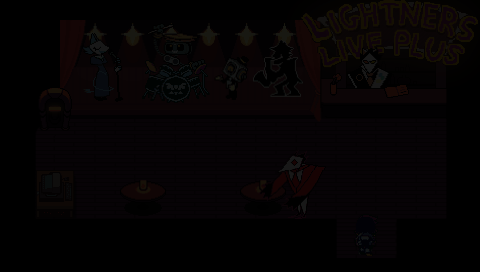

## Screenshots

  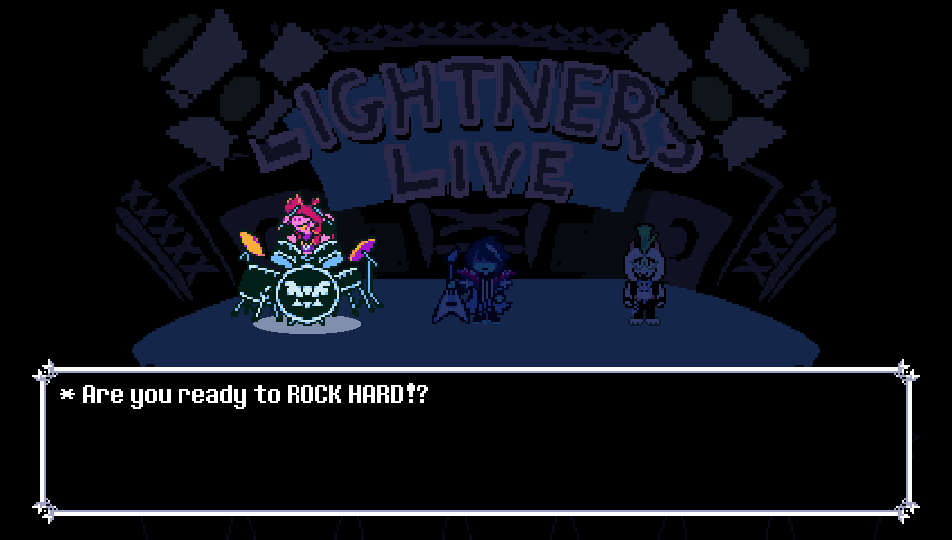
  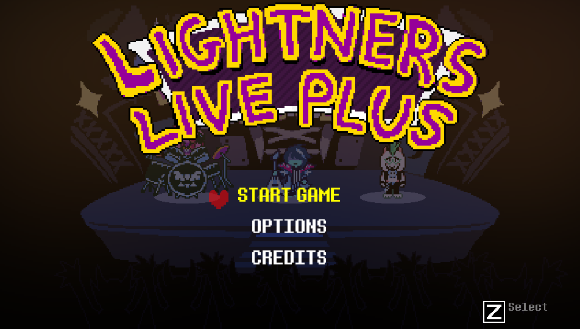
   
  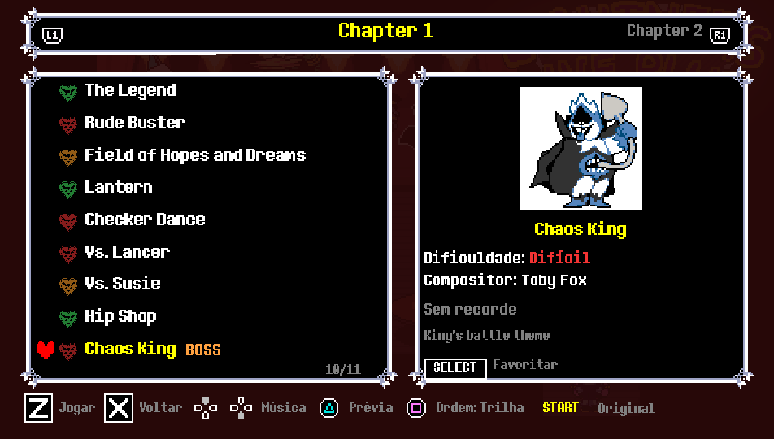
  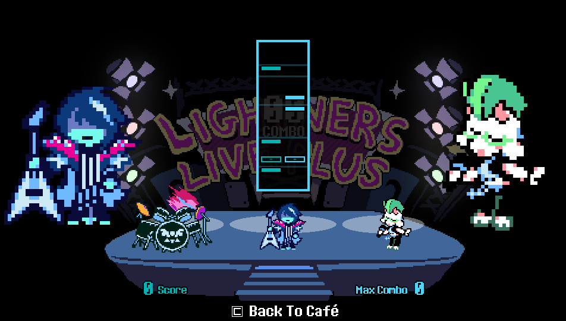
   
  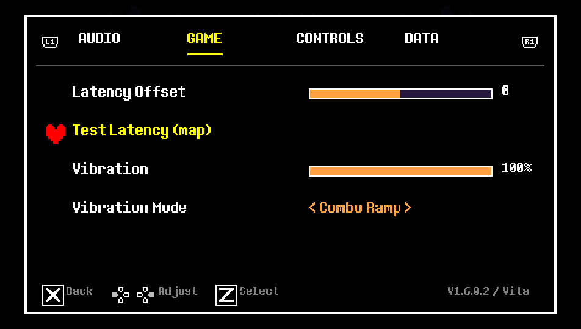
  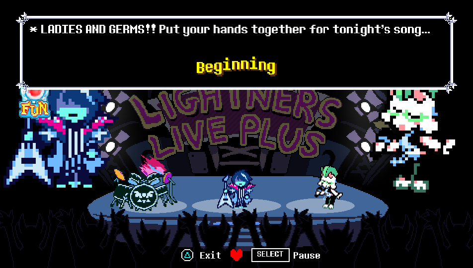
   
  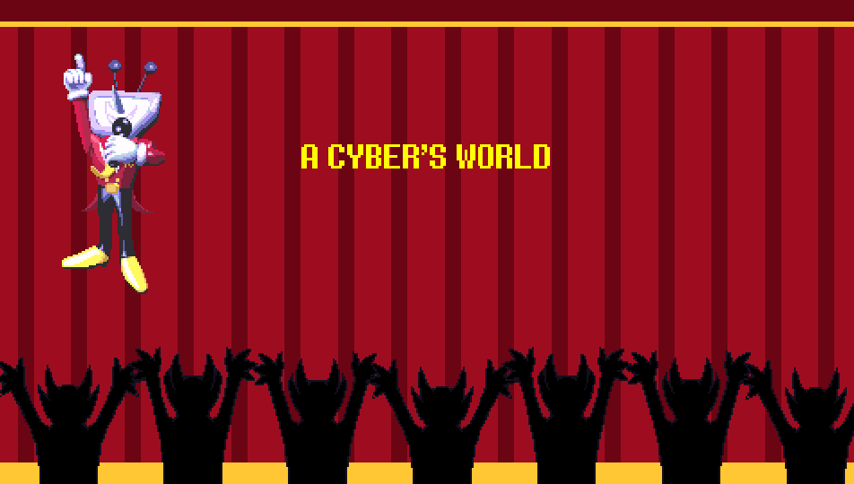
  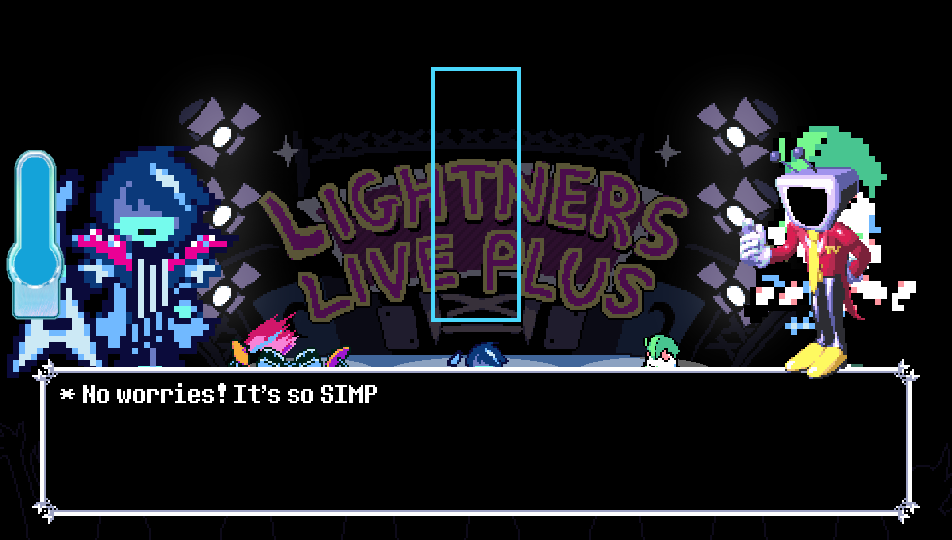
   
  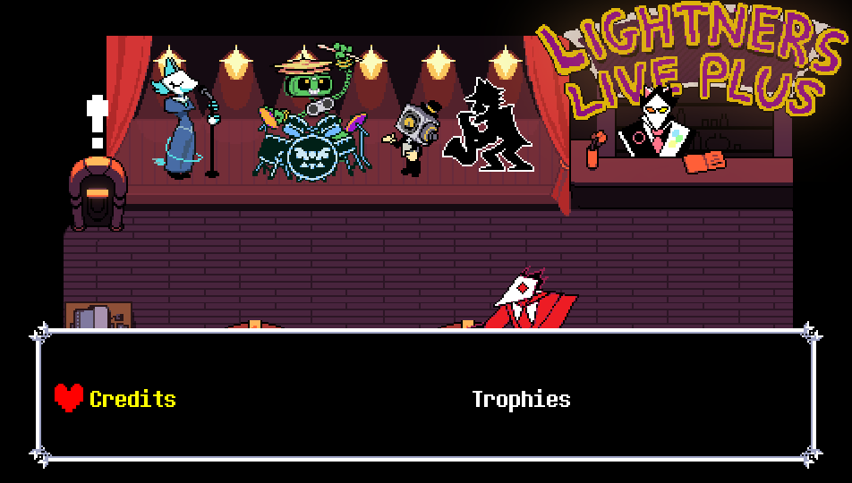
  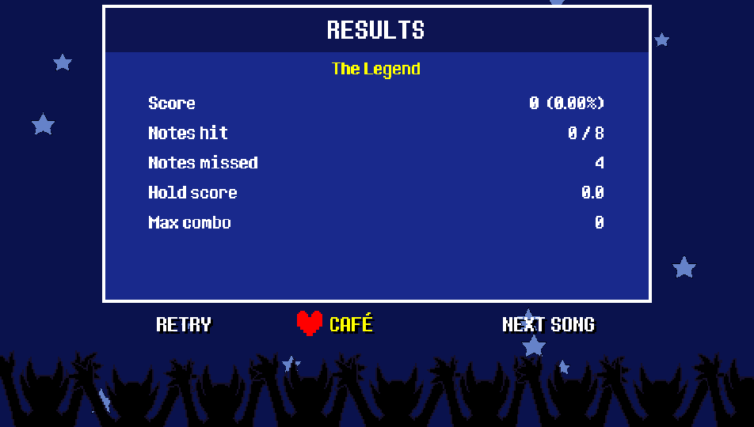

<em>Captured from the Vita game data running on the PC test build (960 × 544).</em>

## About the port

*Deltarune: Lightners Live Plus* is a fan-made rhythm game by **EzioEagle**, built around the *Lightners Live* minigame from DELTARUNE Chapter 3, with songs from every chapter and Undertale. This project runs the original game's Godot content through a PlayStation Vita-specific runtime rather than recreating it in another engine.

The Vita renderer only draws rectangles and textured sprites, so every new screen in the port is built from those pieces:

- **Opening:** the dark stage, one spotlight per band member, Susie and Ralsei's lines with their Chapter 3 voices, the crowd, the bell and Tenna's "ROCK CONCERT" entrance.
- **Title menu:** Start Game, Options and Credits with the red SOUL as the cursor and Deltarune menu sounds.
- **Options:** tabbed screen (Audio, Game, Controls, Data) for volumes, latency offset, vibration and button prompts. Talking to Swatch in the café opens it after a short dialog.
- **Welcome messages:** Tenna delivers the first-time and update notes as dialog instead of text panels.
- **Song select:** chapter tabs on L / R, the SOUL cursor, cover art, difficulty, composer, best score with full-combo colours and the cover-music toggle.
- **The show:** every song opens on the real stage like the first Lightners Live in Chapter 3 (band in silhouette, spotlights, crowd, Tenna's announcement), with Tenna's tutorial on the first play.
- **Fun-O-Meter:** the Chapter 3 meter fills with good playing; at half, Star Power turns the notes orange for double points.
- **Results:** a blue results screen with Retry / Café / Next song, while the Chapter 3 audience applauds.
- **Best Songs:** a tab with ten standout DELTARUNE tracks.
- **Languages:** English, Spanish and Brazilian Portuguese, switchable in Options.

This is an **unofficial fan project**, not affiliated with or endorsed by EzioEagle, Toby Fox, Sony, or the Godot Engine project.

## Controls

| Vita | Action |
| :--- | :--- |
| L / D-pad left / Cross | Left note lane |
| R / D-pad right / Circle | Right note lane |
| D-pad | Move in the café and in menus |
| Cross | Confirm / interact |
| Circle | Back (hold to run in the café) |
| L / R (menus) | Switch tabs |
| Square | Cover music toggle (song select) / Star Power (during a song) |
| Triangle (hold) | Return to the café during a song |

## Current development priorities

- Confirm the new show flow, Fun-O-Meter and results screen on hardware.
- Measure song select and gameplay frame rate on the Vita.
- Prepare an installation method that does not redistribute the game's files.

See [Development status](docs/PORT_STATUS.md).

## Technical background

This port is built around [Godot 4 Vita](https://github.com/WolffsRoom/godot4-vita), [VitaSDK](https://vitasdk.org) and a native [GXM](https://www.psdevwiki.com/vita/SceGxm) 2D rendering path. The game targets Godot 4.6; the Vita runtime is a Godot 4.8 development build loaded by a small Vita executable.

Song charts are MIDI files played through a portable MIDI reader, with the note clock calibrated against the audio position on the Vita. The game data ships as one `game.pck` that is mounted before the game's own scripts start, which cuts the file and folder lookups on the memory card.

## Credits

- [EzioEagle - Lightners Live Plus](https://ezioeagle.itch.io/lightners-live-plus): original game, charts, covers and design ([links](https://ezioeagle.carrd.co)).
- Lateasusual, _imbit, orodelta and rvpine: contributors to the original game.
- [Toby Fox and the DELTARUNE team](https://deltarune.com): DELTARUNE, its characters, music and the Lightners Live minigame.
- [Godot Engine](https://godotengine.org): original engine.
- [WolffsRoom / Godot 4 Vita](https://github.com/WolffsRoom/godot4-vita): experimental Vita runtime and rendering backend.
- [VitaSDK](https://vitasdk.org) and the wider PS Vita homebrew development community.

---

<em>This repository is documentation-only during development.
The original game and all of its associated intellectual property remain the property of their respective rights holders.</em>

