<p align="center">
  An unofficial port of <a href="https://ezioeagle.itch.io/lightners-live-plus"><strong>Deltarune: Lightners Live Plus</strong></a> for PlayStation Vita.
</p>

<p align="center">
  <em>Powered by a customized <a href="https://github.com/WolffsRoom/godot4-vita">Godot 4 Vita</a> runtime, with native GXM 2D rendering and a Vita-made Deltarune-style show around every song.</em>
</p>

> [!IMPORTANT]
> This repository and its releases do **not** include the games' files. The patcher builds the Vita data from your own copies of *Deltarune: Lightners Live Plus* (free on [itch.io](https://ezioeagle.itch.io/lightners-live-plus)) and *DELTARUNE* Chapters 1–4 ([Steam](https://store.steampowered.com/app/1671210/)).

## Project status

<div align="center">
  <a href="https://github.com/WolffsRoom/DeltaruneLightnersVita/releases"></a>
  <a href="https://github.com/WolffsRoom/DeltaruneLightnersVita/releases/latest"></a>
  <br>
  <a href="https://ezioeagle.itch.io/lightners-live-plus" target="_blank"></a>
  <a href="https://github.com/WolffsRoom/godot4-vita" target="_blank"></a>
  
</div>

<br>

<div align="center">

_If you enjoy my work, consider supporting the development!_

[](https://www.buymeacoffee.com/5rsrt7j4z8f)

</div>

For release-specific changes, see the latest [Release](https://github.com/WolffsRoom/DeltaruneLightnersVita/releases/latest). Component-by-component status is in [Development status](docs/PORT_STATUS.md).

## About the port

*Deltarune: Lightners Live Plus* is a fan-made rhythm game by **EzioEagle**, built around the *Lightners Live* minigame from DELTARUNE Chapter 3, with songs from every chapter and Undertale. The port runs the original game's songs, charts and scoring on the Vita and builds a full show around them:

- **The show:** every song opens on the Chapter 3 stage, with the band in silhouette, spotlights, the crowd and Tenna announcing the song.
- **Fun-O-Meter and Determination Power:** good playing fills the Chapter 3 meter; touch the SOUL at the bottom of the screen for glowing notes and double points. An empty meter means *Lights Out*.
- **Boss battles:** boss songs stop for a real battle. The boss stands on the right with its own sprites, bullets and sounds, you dodge with the SOUL, hits cost points, grazes earn them, and the boss closes with a line in its own voice. Every Undertale song has its own fight.
- **Story mode:** songs unlock in the official OST order; each chapter opens after the previous chapter's final boss, and Undertale after Chapter 4.
- **CONCERT RESULTS:** the Chapter 3 evaluation screen with missed, normal and gold notes, longest combo, total score and rank.
- **Trophies:** 30 PS Vita trophies through NoTrpDrm.
- **Interface:** Deltarune-style title, options, song select (difficulty hearts, covers, favourites, song preview), dialog boxes with voices and loading screen, in English, Spanish and Brazilian Portuguese.

<p align="center">
  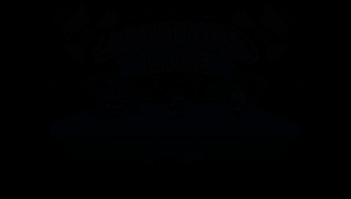
  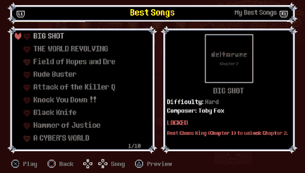
  <br>
  <sub><b>Boot and title menu</b>: the Chapter 3 opening, then Start Game / Options / Credits. &nbsp; <b>Song select</b>: a locked song, the preview on △ and the show opening.</sub>
  <br><br>
  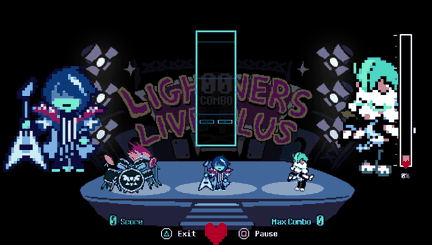
  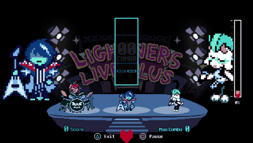
  <br>
  <sub><b>Boss battle</b>: playing Chaos King, then the King's side spades and sky chains. &nbsp; <b>Undertale battle</b>: MEGALOVANIA, Sans and his bones.</sub>
</p>

### Original game vs. PS Vita port

The songs, charts, scoring and save data are the original game's. The original was made for keyboard, mouse and a PC screen, and its interface relies on drawing features the Vita renderer does not have, so the port rebuilds those screens in a Deltarune style.

| | Original (PC) | PS Vita port |
| :--- | :--- | :--- |
| **Boot** | Starts straight in the café | Chapter 3 Lightners Live opening, then a title menu |
| **Settings** | One panel with sliders | Tabbed Options (Audio, Game, Controls, Data) after a dialog with Swatch |
| **Song select** | Scrolling text list | Chapter tabs, story unlocks, difficulty hearts, covers, favourites, preview |
| **During a song** | Score and combo | Fun-O-Meter, Determination Power, SOUL, progress bar, boss battles |
| **End of a song** | Score text | CONCERT RESULTS with rank, Retry / Café / Next song |
| **Languages** | English | English, Spanish and Brazilian Portuguese |

<p align="center"><b>Song select</b><br>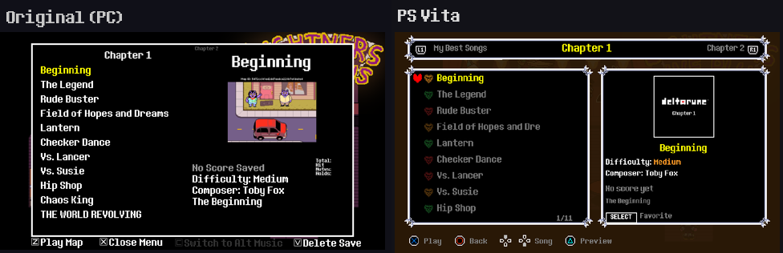</p>
<p align="center"><b>Gameplay</b><br>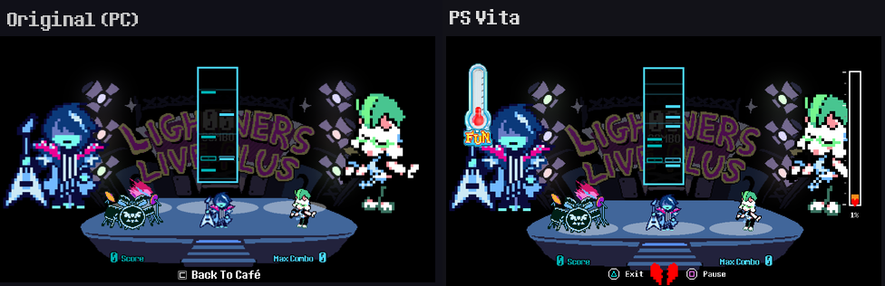</p>

### Technical background

The port runs the original Godot content through [Godot 4 Vita](https://github.com/WolffsRoom/godot4-vita) (a Godot 4.8 development build loaded by a small Vita executable) with a native [GXM](https://www.psdevwiki.com/vita/SceGxm) 2D renderer, which draws rectangles and textured sprites only; every new screen is built from those two primitives. Charts are MIDI files read by a portable reader with the note clock calibrated to the audio, the data ships as one `game.pck`, and trophies are unlocked by the loader through NoTrpDrm.

## Screenshots

<p align="center">
  
  
  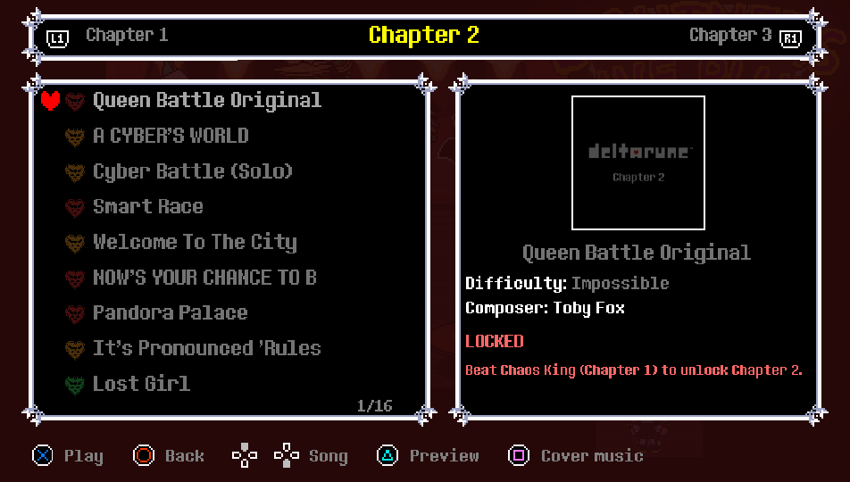
  <br>
  
  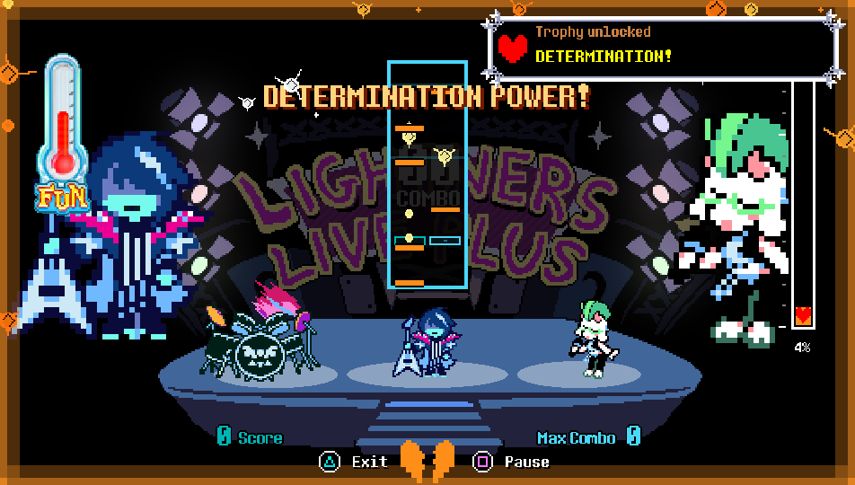
  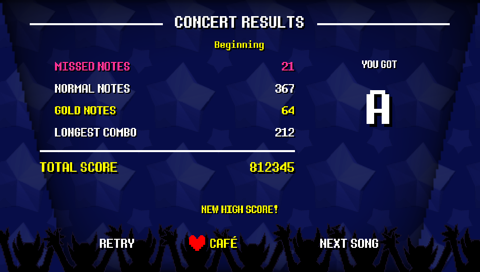
  <br>
  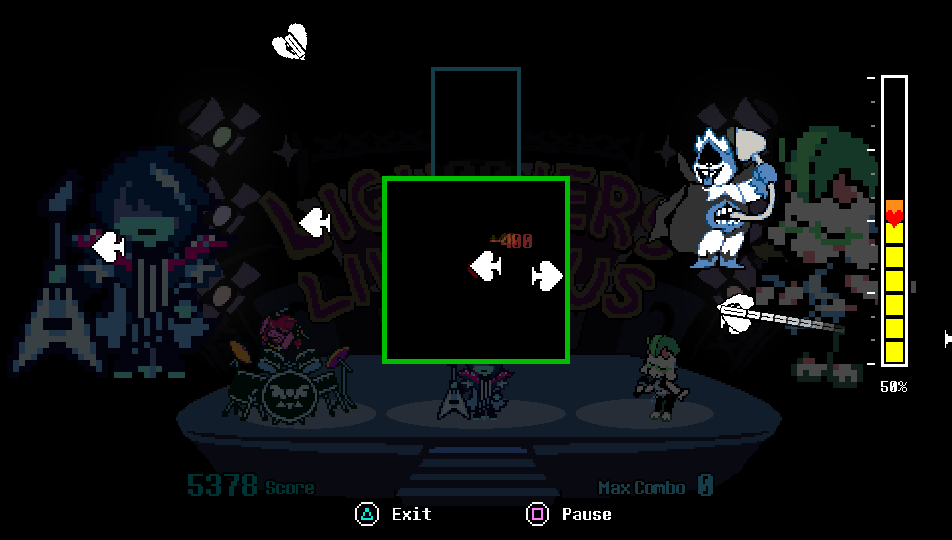
  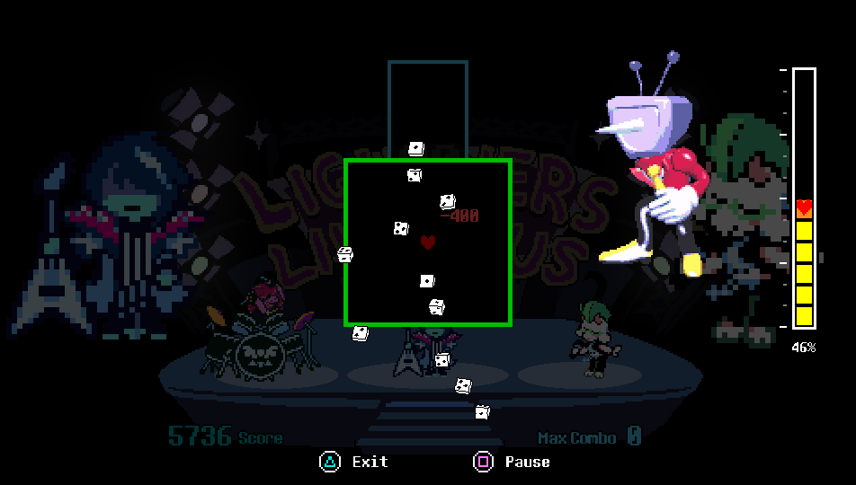
  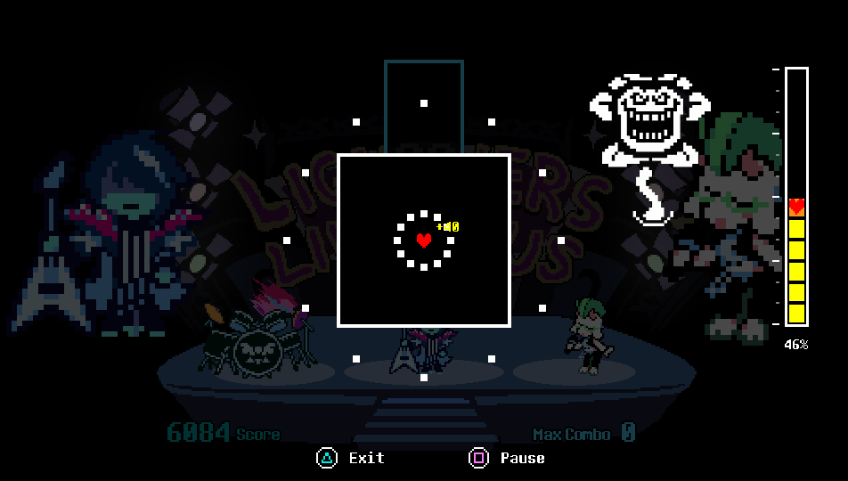
  <br>
  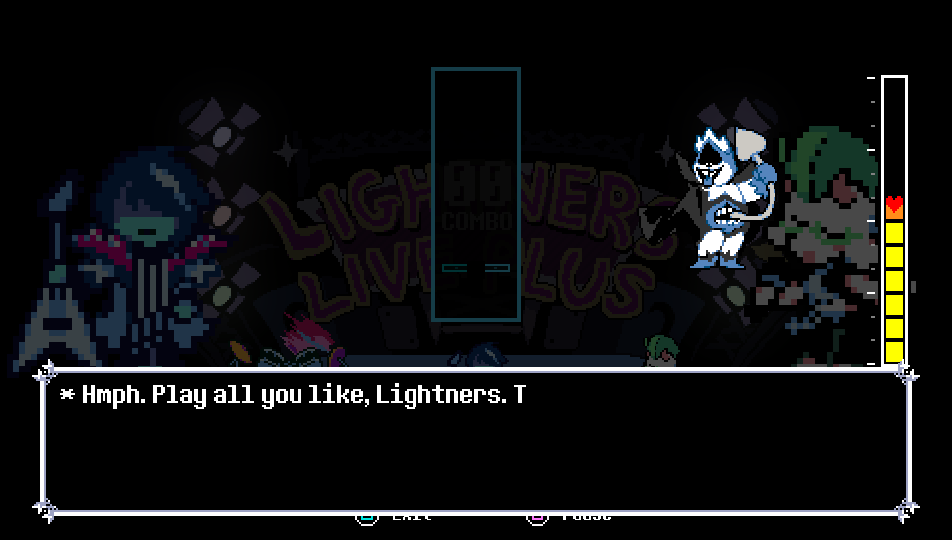
  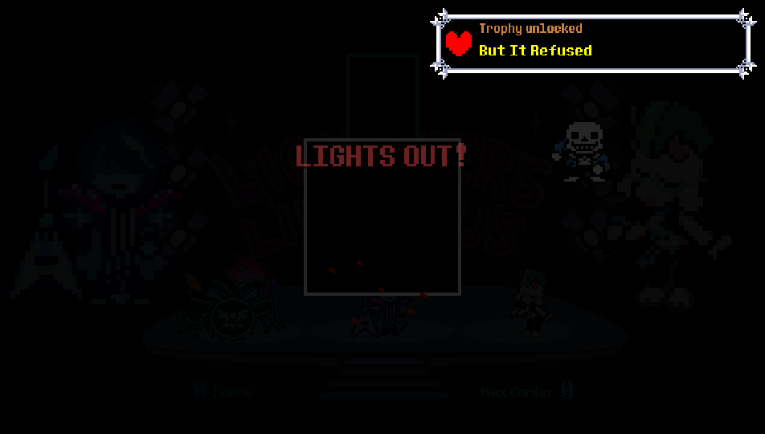
  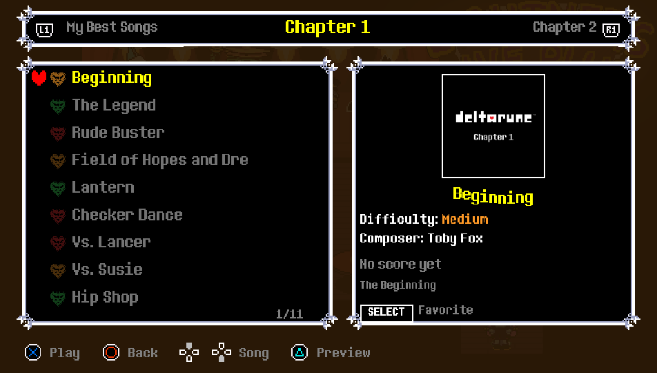
  <br>
  
  
  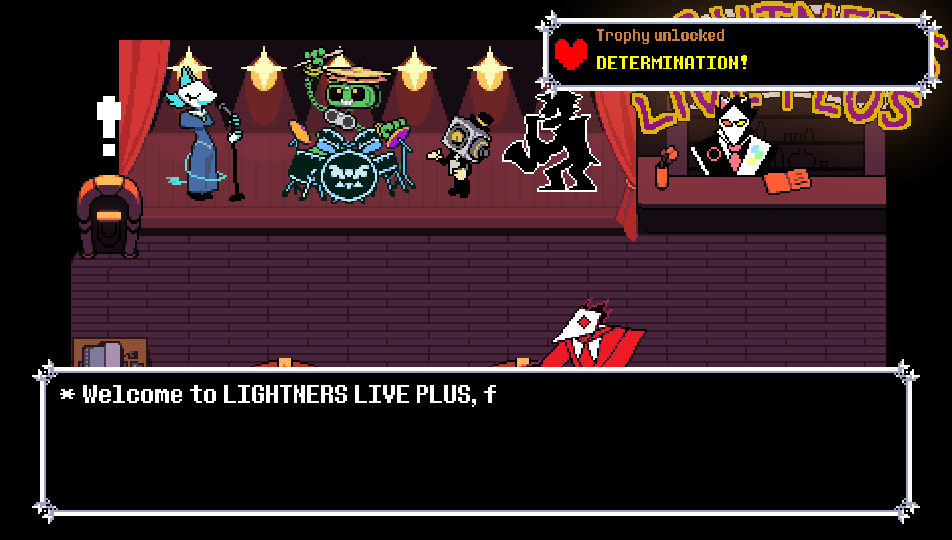
  <br>
  
  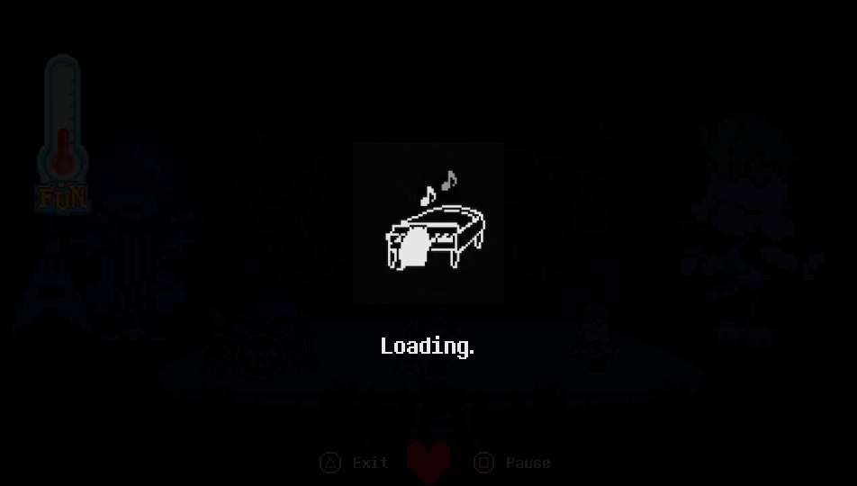
  
</p>

<p align="center"><em>Captured from the Vita game data running on the PC test build (960 × 544).</em></p>

## Controls

<p align="center">
  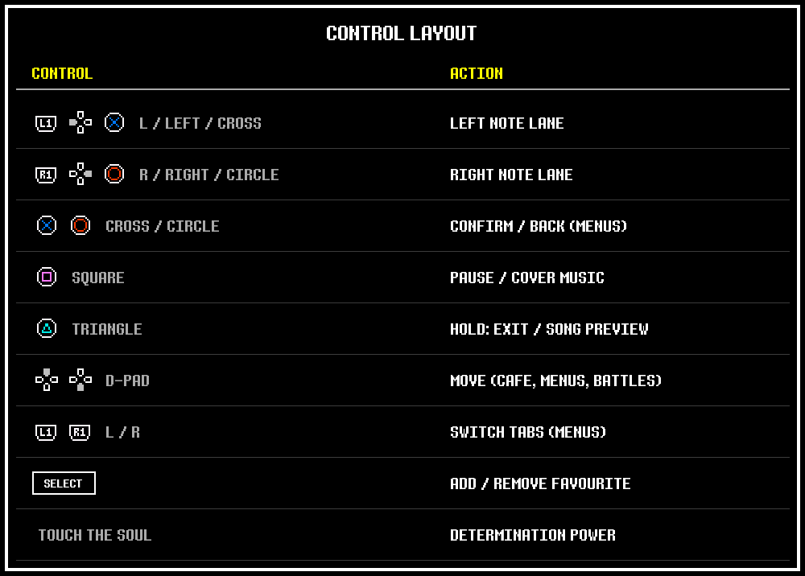
</p>

## How to install

### Requirements

- A homebrew-enabled PlayStation Vita with [VitaShell](https://github.com/TheOfficialFloW/VitaShell/releases);
- [kubridge](https://github.com/TheOfficialFloW/kubridge/releases/) under `*KERNEL` in taiHEN's `config.txt`;
- [Deltarune: Lightners Live Plus 1.6.0.2](https://ezioeagle.itch.io/lightners-live-plus) for Windows (free);
- [DELTARUNE](https://store.steampowered.com/app/1671210/) for PC (Steam) with Chapters 1–4 installed;
- optional: [NoTrpDrm](https://github.com/Rinnegatamante/NoTrpDrm/releases) for trophies.

```text
*KERNEL
ux0:tai/kubridge.skprx
```

### Installing the game

1. Download `deltalightplusvita.vpk` and `Lightners Live Plus Vita Patcher v1.0.zip` from the [latest release](https://github.com/WolffsRoom/DeltaruneLightnersVita/releases/latest).
2. Run `LightnersVitaPatcher.exe`, drag the **Lightners Live Plus** folder (with `Deltarune Lightners Live Plus.pck`) into the window, then the **DELTARUNE** Steam folder (with `chapter1_windows` … `chapter4_windows`), and wait. Every generated file is checked by SHA-256.
3. Copy the generated `deltalightplusvita` folder to `ux0:data/` on the Vita.
4. Install `deltalightplusvita.vpk` using VitaShell.

The final path must be:

```text
ux0:data/deltalightplusvita/game_data/
```

When updating, back up `game_data/custom` first if you have custom maps there.

### Custom maps

Put each custom map folder in `ux0:data/deltalightplusvita/game_data/custom/` and open them from the café PC.

### Trophies (NoTrpDrm)

With NoTrpDrm installed, the game registers its trophy set on the first boot (a system dialog appears once) and unlocks trophies as you play: each boss, each chapter, the first song, the first Determination Power, the first Lights Out and the first lost battle. Clearing every Undertale song is the final reward. If the trophy setup ever fails, delete `ux0:data/deltalightplusvita/trophy_disabled` to try again; the log is `logs/trophy.log`.

## Credits

- [EzioEagle - Lightners Live Plus](https://ezioeagle.itch.io/lightners-live-plus): original game, charts, covers and design ([links](https://ezioeagle.carrd.co)).
- Lateasusual, _imbit, orodelta and rvpine: contributors to the original game.
- [Toby Fox and the DELTARUNE team](https://deltarune.com): DELTARUNE, UNDERTALE, their characters, music and the Lightners Live minigame.
- [Undertale Wiki](https://undertale.wiki): reference sprites for the Undertale characters not present in DELTARUNE.
- [Godot Engine](https://godotengine.org): original engine.
- [WolffsRoom / Godot 4 Vita](https://github.com/WolffsRoom/godot4-vita): Vita runtime and rendering backend.
- [Rinnegatamante - NoTrpDrm](https://github.com/Rinnegatamante/NoTrpDrm), [VitaSDK](https://vitasdk.org) and the wider PS Vita homebrew community.

This is an **unofficial fan project**, not affiliated with or endorsed by EzioEagle, Toby Fox, Sony, or the Godot Engine project.
